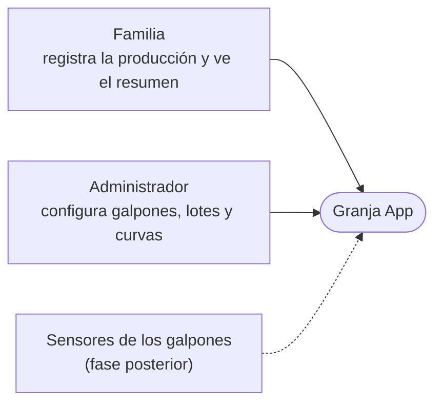
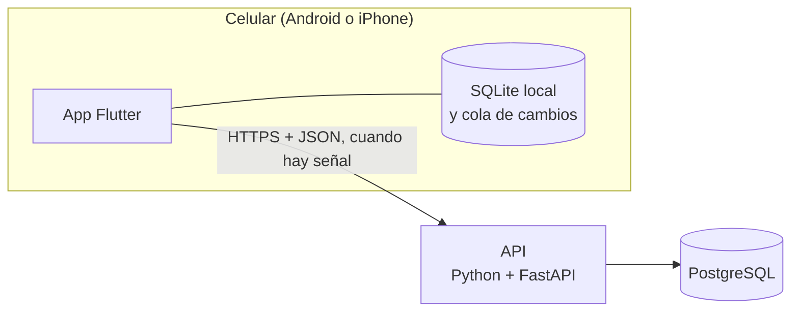
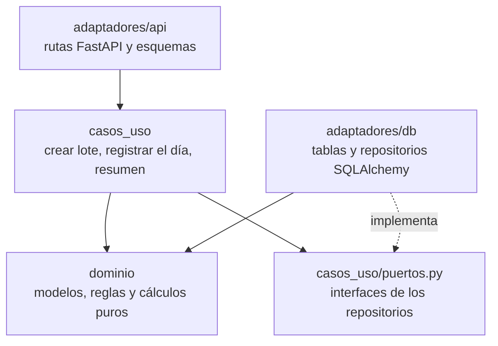

# Arquitectura

El backend sigue una arquitectura hexagonal (puertos y adaptadores): las reglas del negocio no dependen de la base de datos ni de la API. Así se prueban solas, sin base de datos, y se puede cambiar la parte visual o el motor de base de datos sin tocarlas. Los diagramas siguen los niveles del modelo C4.

## Nivel 1: contexto

## Nivel 2: contenedores

El registro del día se guarda primero en el celular. La cola de cambios lo envía cuando vuelve la conexión, y como cada registro lleva un id generado en el celular, reenviarlo no lo duplica.

## Nivel 3: componentes del backend

| Carpeta | Qué tiene | Puede importar |
| --- | --- | --- |
| `app/dominio/` | Modelos (`dataclasses`), reglas de lotes, cálculos de producción y fechas, errores del negocio | Solo la biblioteca estándar |
| `app/casos_uso/` | Lo que la app hace (crear lote, guardar registro, resumen) y los puertos que necesita | `dominio` |
| `app/adaptadores/api/` | Rutas de FastAPI, validación de entrada con Pydantic y traducción de errores a códigos HTTP | Todo |
| `app/adaptadores/db/` | Tablas y repositorios con SQLAlchemy | Todo |

La regla de dependencias se revisa sola: `tests/test_arquitectura.py` falla si `dominio` o `casos_uso` importan FastAPI, SQLAlchemy, Pydantic o un adaptador.

Los errores del negocio (`NoEncontrado`, `Conflicto`, `DatosInvalidos`) se lanzan en el dominio y en los casos de uso. La API los convierte en 404, 409 y 422.

## App móvil

La app Flutter usa las mismas tres capas:

| Carpeta | Qué tiene |
| --- | --- |
| `app/lib/dominio/` | Entidades y reglas en Dart puro, como la postura y la etapa del lote |
| `app/lib/datos/` | SQLite local, cliente de la API y cola de sincronización |
| `app/lib/presentacion/` | Pantallas y widgets |

Las pantallas nunca hablan directamente con SQLite ni con la API: piden los datos a la capa de datos. Así el diseño se puede cambiar sin tocar las reglas.

## Seguridad

- La API todavía no tiene autenticación. No se expone a internet hasta tener usuarios y roles, que es el siguiente paso del plan.
- La entrada se valida en el borde (Pydantic) y las reglas en el dominio.
- Los secretos van en variables de entorno (`.env`), nunca en el repositorio.
- Al desplegar: solo HTTPS, la base de datos sin acceso público y CORS cerrado, porque la app móvil no lo necesita.
- El CI corre con permisos de solo lectura y Dependabot revisa las dependencias cada semana.

## Pruebas

| Archivo | Qué prueba |
| --- | --- |
| `test_produccion.py`, `test_fechas.py`, `test_lotes.py` | Dominio puro |
| `test_casos_uso.py` | Casos de uso con repositorios en memoria (`tests/fakes.py`), sin base de datos |
| `test_api.py` | De punta a punta por HTTP, con SQLite en memoria |
| `test_arquitectura.py` | La regla de dependencias entre capas |
