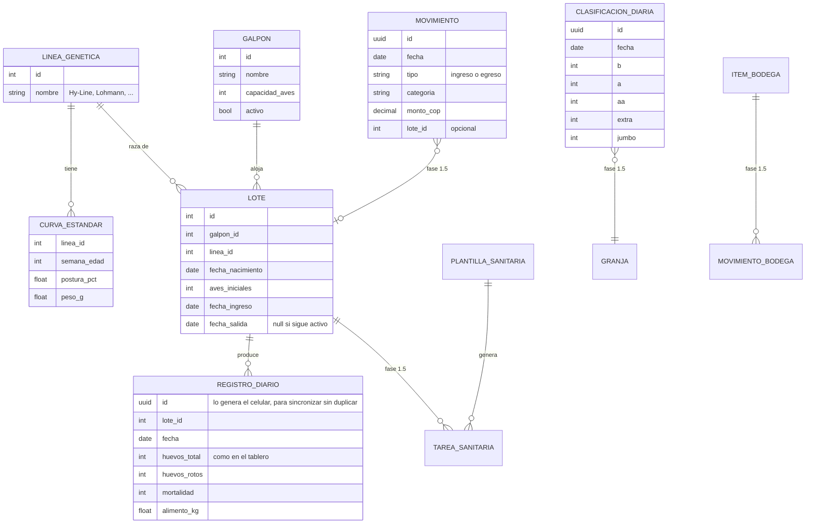

# Modelo de datos

Este es el modelo del MVP descrito en el documento de alcance. La fase 1 (galpones, lotes y registro diario) está implementada en `backend/`. El resto de las entidades se agrega en las siguientes fases, pero ya se tiene en cuenta para no rehacer tablas.

## Decisiones

- **El registro diario es por lote, no por galpón.** En el tablero se anota por galpón, y la app lo pregunta así. Por debajo se guarda en el lote activo de ese galpón, porque las métricas (postura, curva estándar, edad) dependen del lote.
- **Un galpón tiene como máximo un lote activo.** Un galpón sin lote activo está vacío. El día de salida todavía cuenta para el lote que sale, así que el siguiente lote entra como pronto al día siguiente. Un lote no se puede cerrar antes de su último registro.
- **Los registros usan UUID generado en el celular.** Si el celular reenvía el mismo registro al recuperar la conexión, el servidor lo actualiza en vez de duplicarlo.
- **Un solo registro por lote y día.** Si se corrige un dato, se edita el registro existente.
- **La clasificación (B, A, AA, Extra, Jumbo) es aparte y de toda la granja**, porque se hace al empacar y no por galpón.

## Métricas calculadas

| Métrica | Fórmula |
| --- | --- |
| Edad (semanas) | (fecha − fecha_nacimiento) / 7 |
| Etapa | cría < 6 semanas ≤ levante < 18 semanas ≤ producción |
| Aves vivas | aves_iniciales − mortalidad acumulada hasta la fecha |
| Postura % | huevos_total / aves vivas × 100 |
| Alerta de baja postura | postura por debajo de la curva estándar en más de 5 puntos durante 3 días seguidos |

Las semanas de corte de etapa y el umbral de la alerta son configurables, porque cambian según la línea y el criterio del veterinario.
